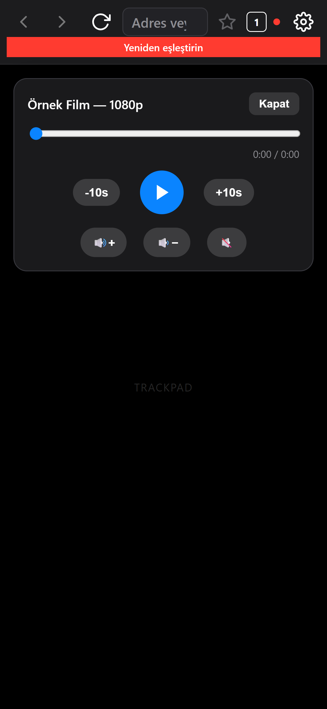
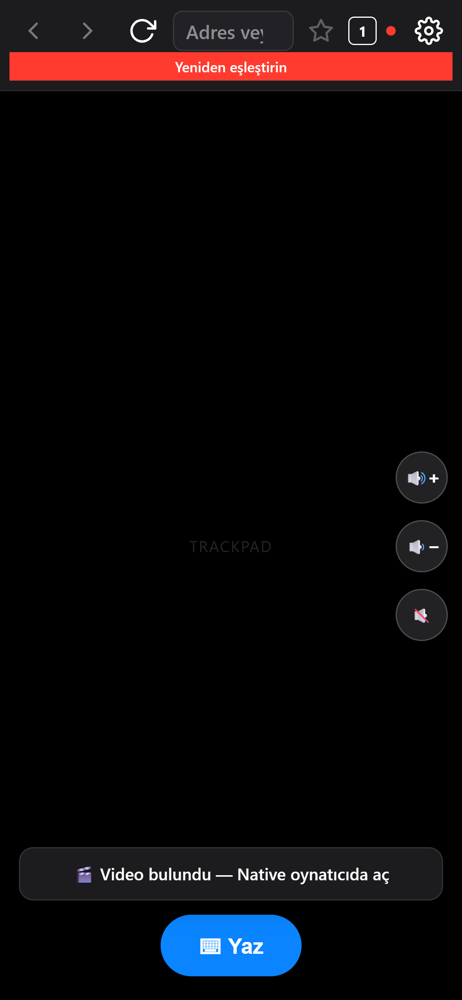
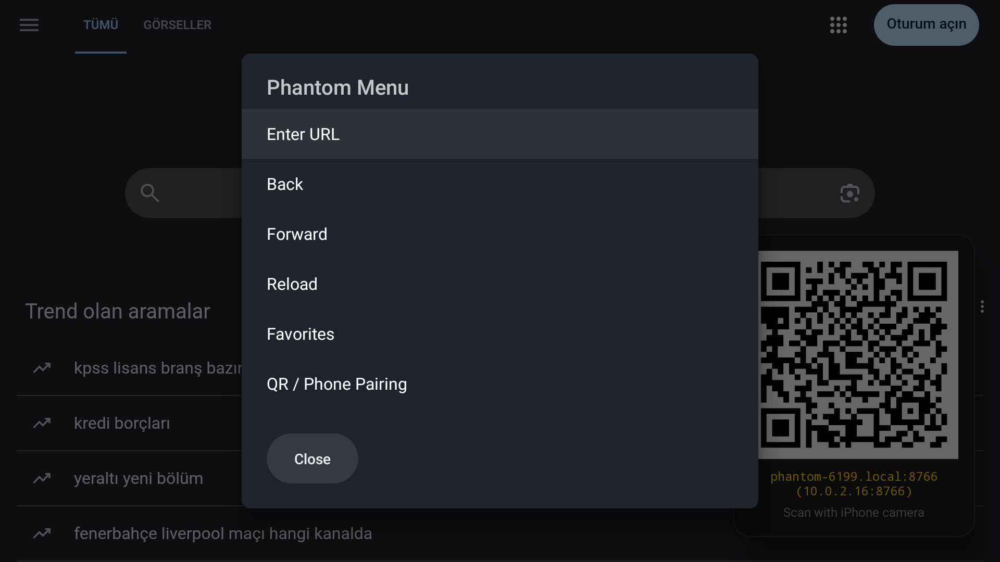
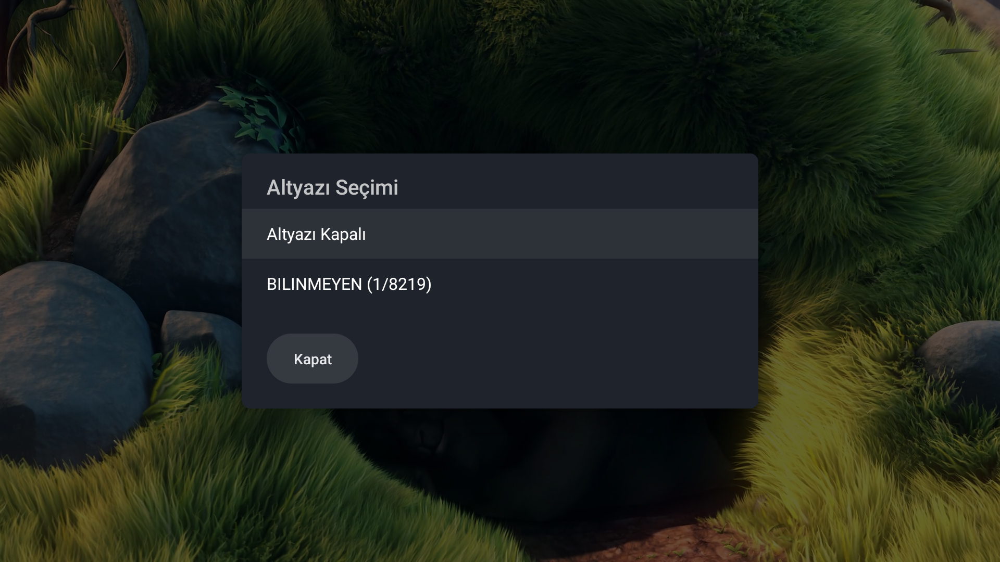

# Loungo: TV Browser

[](https://github.com/brkysfcn/loungo/actions/workflows/test.yml)

A lightweight, fast web browser for **Android TV**, controlled from your phone or your TV remote.
It finds video on any page and opens it in a native full-screen player with subtitles, audio-track and quality selection, and resume.

> Status: beta, in closed testing on Google Play. Requires Android TV 12+ (TV) or Android 12+ (phone remote).

| Phone remote | Video found | TV menu (remote only) | Subtitles in the player |
|---|---|---|---|
|  |  |  |  |

## Features

**First run**
- A short showcase of what Loungo does, then an interactive tour (remote, phone pairing, video). Replay from the menu.
- The phone gets its own tips: gestures, buttons and how to add the remote to the home screen.

**Browsing**
- Full Chromium WebView browser with a mouse-style cursor.
- Built-in ad and tracker blocking (filter list plus a small general list).
- Pop-up and redirect protection: other-site navigations need a click.
- Favorites.
- Clear browsing data (cookies, cache, site data) from the phone; pairing is kept.

**Phone remote**
- Android: install Loungo on the phone too. It opens as the remote, finds the TV on the same Wi-Fi and pairs when you approve "Connect this phone?" on the TV. No QR, no camera.
- iPhone (or any phone browser): scan the QR code on the TV and add the page to the home screen.
- Trackpad, keyboard and volume controls; player panel with seek and track selection.
- Pull from the trackpad's left edge to go back; paste into page fields; drop-down lists work from the phone.
- Finds the TV by its `loungo-xxxx.local` name, so a changing IP address does not break the remote.

**TV remote only**
- Cursor on the D-pad; holding a direction at the screen edge scrolls the page.
- Long-press OK for the menu: enter URL, back/forward, reload, pairing, how to use, about.
- A banner appears when a page has video; Play opens it in the native player.

**Native player (Media3/ExoPlayer)**
- Detects HLS, DASH and MP4 by content, not only by file extension, and prefers the master playlist.
- Repeats the request headers the page itself sent for the stream (referer, origin, ...).
- Subtitles from the stream or the page; Turkish is preferred.
- On wide (letterboxed) films, subtitles sit in the black bar under the picture.
- Settings menu on the remote (Up): subtitles, audio language, quality. Only hardware-decodable tracks are offered.
- Resume where you left off, keyed by page.

**Light by design**
- The background service runs only while the app is open; the page stops in the background and the cursor loop sleeps when idle.
- Light look: on weak TVs, a stuttering page gets its background blur turned off automatically (phone settings: Automatic / Always / Off).
- Release APK ≈ 4.6 MB. Cold start ≈ 1 s and idle memory ≈ 82 MB on the TV emulator.
- No analytics, no accounts. Everything stays on the local network.
- English and Turkish UI.

## Architecture

```
┌──────────── Android TV (app/) ─────────────┐         ┌──── Phone (pwa/) ────┐
│ BrowserActivity  ── WebView + cursor        │  HTTP   │ Vite + TypeScript PWA │
│   ├─ web/      MediaDetector, AdBlocker,    │◄───────►│ trackpad, keyboard,   │
│   │            NavigationFilter, PopupGate  │   WS    │ player panel, i18n    │
│   ├─ input/    cursor, remote motion        │ (8765)  └───────────────────────┘
│   └─ player/   NativePlayerActivity (Media3)│
│ CoreService ── NanoWSD server, pairing,     │   mDNS: loungo-xxxx.local
│                MdnsResponder, EventLogStore │
└─────────────────────────────────────────────┘
```

The wire protocol is documented in [`docs/protocol.md`](docs/protocol.md). Shared test vectors are in [`docs/protocol_vectors.json`](docs/protocol_vectors.json); both the Kotlin and TypeScript tests use them.

## Building

Requirements: JDK 17+ (Android Studio's JBR is fine), Android SDK 36, Node 20.

```bash
./gradlew assembleBetaDebug        # "Loungo TEST" (com.phantom.browser.test, port 8766)
./gradlew assembleStableRelease    # "Loungo" (com.phantom.browser, port 8765), signed
```

The Gradle build also builds the phone PWA into `app/src/main/assets/pwa/`. Add `-PskipPwa` when the PWA has not changed.

**Flavors.** `stable` is the app you use day to day. `beta` installs next to it as **Loungo TEST** so tests never overwrite it.

**Release signing.** Use your own key. Put these values in `~/.gradle/gradle.properties` (debug builds need none of this):

```properties
PHANTOM_STORE_FILE=/path/to/phantom-upload.jks
PHANTOM_STORE_PASSWORD=...
PHANTOM_KEY_ALIAS=phantom
PHANTOM_KEY_PASSWORD=...
```


## Testing

```bash
./gradlew testBetaDebugUnitTest -PskipPwa   # JVM tests: protocol, media detection, policies, player helpers
cd pwa && npx vitest run                    # PWA tests
```

GitHub Actions runs both on every push.

## Repository layout

| Path | Contents |
|---|---|
| `app/` | Android app (Kotlin): the TV browser and the phone remote screen |
| `pwa/` | Phone remote web page (Vite, TypeScript), served by the TV |
| `tools/` | Brand image, ad-list and dev-client scripts |
| `docs/` | Protocol, store texts and graphics |

## Privacy

The app collects no data. The phone talks to the TV directly on the local network, and pairing uses a per-TV token. "Report a problem" sends logs only when you share them yourself.

## Contributing

Issues and pull requests are welcome. By submitting a contribution you agree that it is licensed under GPL-3.0 **and** that the project owner may also distribute it under other terms (for example in the Google Play build).

Please keep site-specific code out: Loungo solves things with general rules, not per-site lists.

## License

Copyright © 2026 brkysfcn. Licensed under the [GNU General Public License v3.0](LICENSE).

"Loungo" and the Loungo icon are not covered by the license; please use a different name and icon for your own builds.

---

**Türkçe özet:** Loungo, Android TV için hafif bir tarayıcı. Telefondan (Android uygulaması ya da iPhone'da QR ile açılan sayfa) veya TV kumandasından kontrol edilir. Sayfadaki videoyu bulup altyazı, ses dili ve kalite seçimiyle tam ekran oynatıcıda açar. GPL-3.0 lisanslıdır; katkılar memnuniyetle karşılanır.
